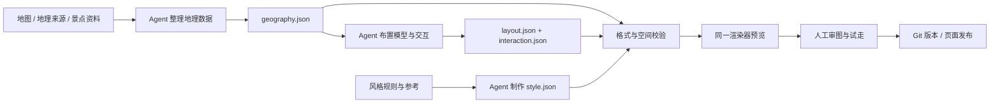

# 地图数据包 v1 与 Agent 制作流程

这次把西湖大地图拆成四种可编辑、可版本管理的数据文件。页面的 Three.js 渲染器读取这些文件，「湖山微缩」「纸艺西湖」「像素西湖」「积木乐园」「卡通冒险」五种风格共享同一份地理、布景和交互数据。风格与春晓、夏荷、夕照、秋月、残雪五种时节分开，可组合选择。

## 交付物与边界

| 文件 | 职责 | 修改时必须保持的约束 |
| --- | --- | --- |
| `src/map3d/data/westlake/manifest.json` | 包版本、地图 ID、四层关联、可用风格 | `schemaVersion: 1`；关联同一个 mapId |
| `geography.json` | 原点、坐标比例、湖岸、岛屿、堤桥、山体参数、路网、景点位置与世界朝向 | 1 单位为 100 米；x 向东、z 向南；水面 y=0；保留来源及人工修订说明 |
| `layout.json` | 18 个模型实例、位置/朝向/尺度、地图文字、植被规则、荷花、鱼池和游船 | `catalogVersion: 1`；每个景点对应唯一模型实例；不改地理路网来迎合风格 |
| `interaction.json` | 起点、相机、步行/游船速度、到达范围、路线权重、时间估算 | 用已有节点 ID；相机范围有效；行走与地形一致 |
| `src/map3d/styles/*.json` | 颜色、材质、造型策略、可选阶梯地形参数、底座、灯光、季节、后期效果 | 风格改变表现，不改变景点、道路和可达关系 |
| `schemas/map-*.schema.json` | JSON Schema 2020-12，供编辑器/生成 Agent 校验 | 与 `src/map3d/contract.js` 同源；构建检查它们是否一致 |

样例文件就是当前运行中的完整数据，不是只给 PPT 用的结构示意。文件中不允许放 JavaScript、表达式或远程脚本。模型使用受控模型库里的名称：`stele-pavilion`、`lake-terrace`、`pavilion`、`three-lanterns`、`pagoda`、`slender-pagoda`、`arch-bridge`。增加新造型需要实现模型库，再扩展版本/校验规则；不能凭空填写未支持的模型 ID。

地理位置和地形是两类精度：湖岸和主堤来自 OpenStreetMap，山体高度、部分连接道路、堤宽及模型比例经过展示性处理，不是测绘数据。实际营业、安全与通行信息需景区确认。绘卷图片与三维底图仍是不同资产，上传图片本身不会自动产生可信经纬度。

## 本次实际执行的流水线



这次由一个 Codex 按步骤执行。角色分工、结构化交付、验证和人工审核已能用仓库文件及命令承载；它们不要求先搭建多个独立 Agent 服务。将来可以把各步骤分配给不同 Agent，保持交接契约不变。

1. **确认来源与坐标。** Agent 记录来源、许可、原点、单位、边界及人工调整。先建立可核对的地理层，再制作风格。
2. **生成地理候选。** OSM 提取脚本输出 `artifacts/westlake-osm-candidate.json`，导入脚本输出地理候选文件。候选经检查后替换正式数据，避免抓取结果直接覆盖已审布景。
3. **形成可走路网。** 为景点设置停靠点，连接步行/船行边；校验步行采样不落水、景点之间可达。桥面高度来自同一几何函数。
4. **布景。** 使用模型库放置地标，设置名称、spotId、坐标、旋转、尺度及植被/船行规则。水上塔、湖边平台和桥是明确的例外类型，其余陆上模型不能放在水里。
5. **生成风格。** 从现有风格复制一份配置，保持地理、路网、模型实例及精细度。纸艺版改变树冠几何、地表法线、纸张颗粒、纸层底座、建筑材质和水面表现；像素、积木、卡通分别调用不同的屋顶、树冠、城镇和角色造型策略。像素与积木用可校验的 `landform` 控制格宽、台阶高度与起始高度。没有重新生成景点世界模型，也不产生模型 API 费用。
6. **程序验证。** `npm run check:map` 校验结构/引用、模型覆盖、可走节点、每 3 米一处的步行边采样、景点互达及编辑器 Schema。一份包含输入 SHA-256 的报告写入 `artifacts/map-validation.json`。`npm run build` 也必须先通过该检查。
7. **视觉与体验验收。** 桌面与窄屏审图；切换风格和时节；点击景点、自动步行/乘船、看近景、进入已有 SPZ。检查标签、模型位置、相机和材质。人工审核不能仅由“校验通过”替代。
8. **保存与发布。** 审核过的配置、渲染器和素材一起提交到 Git。生产站点发布是独立步骤；本分支先用于本地比较。

## 当前代码边界

- `src/map3d/geography.js`：纯地理编译器，输入 geography + interaction，输出 SDF、地形、桥面、寻路等函数。
- `src/map3d/data/catalog.js`：地图包注册入口。导游、行程、单景点路标和地图通过同一个注册表读取地理实例。
- `src/westlake-geo.js`：旧调用方的兼容入口，坐标已从这里移走。
- `src/map3d/models.js`：通用模型库，按风格创建独立材质/几何/季节变量。风格互不污染。
- `src/map3d/style-geometry.js`：受控造型策略，按风格提供基本体、屋顶、树冠、城镇与角色；没有景区坐标。
- `src/map3d/surface.js`：将地理高度编译为显示高度。阶梯只作用于高于阈值且离岸足够远的山地，保留窄堤与桥面；模型、树木、道路、标签和角色共用此高度。
- `src/map3d/terraces.js`：台阶顶面与可见侧面合并为一个网格，积木凸点使用一个实例网格，不给每块地砖创建独立物体。
- `src/map3d/scene.js`：按布景文件生成完整场景，不再内置西湖景点坐标。
- `src/map3d/index.js`：界面、控制器、视角、路线和印章；风格重建场景时保留当前游览状态。
- `src/map3d/contract.js`：数据契约和引用/语义校验；`scripts/validate-map.mjs` 进一步检查空间关系。
- `src/westlake-osm.js`：改造前的来源快照，保留用于追溯，运行时不再读取。

## 常用命令

```sh
node scripts/export-map-schemas.mjs # 仅修改 contract.js 后需要
npm run check:map
npm test
npm run build
PORT=4176 npm run serve
```

更新地理来源时，先生成候选，检查后再采用：

```sh
python3 scripts/westlake-osm.py
node scripts/import-westlake-osm.mjs artifacts/westlake-osm-candidate.json
# 审核 artifacts/westlake-geography.candidate.json 后替换 geography.json
node scripts/westlake-paths.mjs | python3 scripts/splice-paths.py
npm run check:map
```

路网脚本目前仍是西湖的采样规则，新景区应编写自己的来源整理和路线生成步骤。新增景区需要生成四层文件、注册包、视觉验收；新增风格需要生成配置、注册风格并加入 manifest.styles。仅在维护端添加景点不会自动生成三维模型和地理底图。

## Agent 可复用任务提示词

> 读取本工作流、现有地图包及 schemas。先确认地图来源、地理单位与人工假设，再生成 schemaVersion=1 的 geography、layout、interaction 和 style JSON。不得改变已审核景点事实；不得用风格重排真实地点；不得把无法核实的高度当测量值。复用已有模型目录及渲染器，保持 230 段地形、原有地标细节和游览操作。运行 check:map 和测试，修复引用/空间错误，再做桌面、窄屏、近景、切换与漫游验收。提交文件、校验报告和待人工核对的事项。任何新增模型或格式能力必须先扩展模型库/契约并添加兼容验证。不要把完成渲染等同于已获人工审核或已部署。

## 路演怎么讲

“我们把景区生产拆成标准化地图数据包：地理事实、模型布置、风格和交互分别维护。Agent 按工作流生成，程序验证坐标、路网和模型关系，景区最终审核。同一份内容可以生成不同探索体验，也能被导游、行程卡和世界模型路标复用。”

演示时直接切换五种风格：湖岸、景点和路线保持一致，视觉形态改变；随后进入花港的真实世界模型。技术依据可以展示 JSON、Schema、校验报告和 Git 差异。不要把当前按角色执行的工作流说成已运行多个独立服务，也不要宣称任意一张地图都能全自动准确三维化。

## 本次验收记录

- 基线：`main` 的 `95eed47`；改造分支：`feature/map-pipeline-papercraft`。
- 49 个水环、68 个节点、71 条边、18 个模型实例、6 个景点绑定、5 种视觉风格。
- 固定 225 处地理样本，与改造前的高度、岸线距离和可走性比较；节点、边及景点绑定逐项一致。
- 保留季节、卡片、步行/船行和已有单点世界入口；浏览器检查原版与纸艺版总览、近景及小屏风格菜单。
- 新增测试检查所有风格的模型边界、有限顶点、角色动画接口、台阶射线交点与站立高度、桥面保持和合批顶点预算；全套 46 项测试。
- 校验报告只陈述程序验证结果，现场真实性由景区审核。


## 五种风格的入口与区别

在本地 `http://127.0.0.1:4176/#map?s=westlake` 右上角选择风格。深链接使用 `&style=<id>`；刷新保留 URL 指定风格，界面切换保留角色、路线、时节和印章。菜单支持窄屏滚动与 Escape 收起。

| ID | 名称 | 几何与表现 |
| --- | --- | --- |
| miniature | 湖山微缩 | 原有江南楼阁、柔和山体、烟柳与纸伞人物 |
| papercraft | 纸艺西湖 | 折面树冠、纸张颗粒、分层底座 |
| voxel | 像素西湖 | 体素式阶梯山体、方块树与方形塔檐、方块背包客 |
| bricks | 积木乐园 | 圆角拼装树冠、屋顶与地砖凸点、塑料材质、玩具旅行者 |
| adventure | 卡通冒险 | 云朵树冠、圆润建筑、夸张翘檐、戴帽背包探险家 |

像素风采用三维体素造型语言，保留原湖岸与细窄道路的连续地形；并非将整个场景低分辨率拉伸。积木版的凸点属于装饰，不作为角色碰撞障碍。卡通冒险目前是画面与角色风格，沿用原有漫步、乘船、集章和景点探索，未额外加入战斗或任务系统。

新增另一种风格时，若现有造型词汇能覆盖，只增加 style JSON 并注册；需要新的造型或地形规则时，再扩展策略模块、Schema、自动检查和浏览器验收。不得只填一个尚不存在的 geometry 名称。
