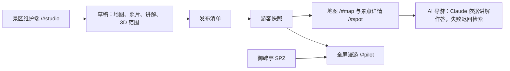

# 技术与服务

维护日期：2026-10-13。本文以仓库代码和生成记录为依据。

## 架构

前端为原生 JavaScript 模块，esbuild 打包；产品官网（`#home`，`src/landing.jsx`）单独使用 React、Motion（滚动联动动画）与 Lenis（平滑滚动），离开官网即卸载，其余页面不依赖它们；Three.js 与 Spark 播放 SPZ Gaussian Splat。公开 Sites 只托管静态 `dist/`；本机 `npm start` 额外提供 `/api/guide`（Anthropic）与 `/api/worlds`（World Labs）两个代理，密钥只在本机。

## 模块

| 文件 | 职责 |
| --- | --- |
| [app.js](../src/app.js) | 路由：`#scenics`（默认）、`#map`、`#spot`、`#pilot`、`#studio`，`?s=` 指定景区 |
| [scenic-workflow.js](../src/scenic-workflow.js) | 游客地图与详情、AI 导游界面、景区维护端 |
| [scenic-core.js](../src/scenic-core.js) | 六视角与补充照片、草稿确认、发布清单与改动、导游检索、漫游范围、状态迁移 |
| [scenic-store.js](../src/scenic-store.js) | IndexedDB 持久化、图片 Blob 存储与回收、上传校验、备份导出 |
| [景区内容目录](../scenics/) / [统一装配器](../src/content/catalog.js) | 每个景区的文案、照片、许可、补图和世界模型配方；由清单装配初始快照 |
| [pilot-world.js](../src/pilot-world.js) | 御碑亭 3D 场景挂载（游客页与维护端共用） |
| [viewer.js](../src/viewer.js)、[navigation.js](../src/navigation.js) | Splat 渲染、步行相机、范围限制 |
| [core.js](../src/core.js) | HTML 转义与链接校验 |
| [web-images.js](../src/web-images.js) | 内置素材到网页副本、上传图片到对象 URL 的显示映射 |
| [server.mjs](../server.mjs) | 本机服务（仅 127.0.0.1，POST 校验 Origin）：静态文件、`/api/guide`、`/api/worlds`（上传、提交、轮询、下载 SPZ 到 `data/worlds/`）、`/generated/` |

## 状态

工作区 schema 为 `8`：`{schema:8,scenics:[…]}`。每个景区包含 `id`、`draft`、`published`（未发布时为 `null`）、`publishedAt`、`publishNumber`，各自发布、互不影响；`.intro` 显示在游客端景区列表。旧的单景区状态（schema 1–7）迁移为 id 为 `westlake` 的景区。

单景点包含地图比例坐标、介绍、`guide`、`notice`、`factSource`、`photos`、`revision`、`confirmedRevision`、`world`、可选 `roam` 和 `pilotAsset`。

- `photos` 的六个视角键为 `front`、`left`、`rear`、`back`、`top`、`inside`；其余照片以 `more-…` 为键，不限数量，游客端排在六个视角之后。
- 图片变化递增 `revision`；`world.kind = generated` 的实时生成结果保留，输入照片变化时 `worldStale` 为真。进行中的任务存在景区的 `jobs`，不进入发布对比。
- 发布清单（`publishProblems`）要求景区名称、每个景点有名称和至少一张图片、所有 AI 图片已接受、3D 演示结果与素材版本一致；每条问题带对应景点和标签。
- `roam` 为六个方向的可漫游距离（米，0–5），缺省用 `DEFAULT_ROAM`。
- `pilotAsset` 绑定御碑亭原始正面照片与实际世界 ID，独立于 `world.kind = demo`。
- 旧 schema 迁移保留自定义素材、点位和已写讲解。

## 数据存储

| 数据 | 位置 |
| --- | --- |
| 所有景区的草稿与游客快照 | IndexedDB `jingjian-scenic-workspace` 的 `workspace/current` |
| 上传的地图与照片 | 同库 `photos` 存储，按 SHA-256 存 Blob；状态中只保存 `idb:<hash>` 引用 |

草稿与快照共用同一张图片，不重复存储；保存后回收不再被引用的图片。旧版本中内嵌的 Data URL 会在首次加载时迁移。备份导出把引用还原为 Data URL，暂无恢复界面。数据只在当前浏览器、当前网站来源，没有云同步或多人协作。

## 真实生成资产

| 日期 | 输入与用途 | 生成记录 | 实际消耗 |
| --- | --- | --- | --- |
| 2026-10-12 | 御碑亭正面实拍；`/#pilot` | [huagang-generation.json](../scenics/westlake/spots/huagang/worlds/huagang-generation.json) | 1,580 credits，记录余额 5,420 → 3,840 |

只提交并成功创建一个世界任务；此前两次 HTTP 422 缺字段校验拒绝未创建任务。五张补图来自内置 imagegen，未参与这次生成。

实时生成：维护端提交 `requestId`，同一编号不会重复提交扣费；4xx 视为明确拒绝并丢弃，超时或 5xx 标记为“不确定”，需到 World Labs 平台核对。一张照片走 `image`，多张走 `multi-image`（正面 0°、右侧 90°、背面 180°、左侧 270°）。完成后下载 500k SPZ，写入含尺度、地面偏移、费用的 `receipt.json`。

## 渲染与资源

Spark 按需加载 500k SPZ。生成回执中的尺度、地面偏移与初始视点用于渲染配置，不能当作实地测绘结果。相机限制在 `roam` 定义的长方体内，维护端 3D 标签可实时调整；没有碰撞、地理导航或无障碍路线验证。

网页图片副本由 [prepare-web-images.mjs](../scripts/prepare-web-images.mjs) 生成并提交，映射与哈希见 [manifest.json](../scenics/westlake/provenance/web-images-v1.json)。[构建脚本](../scripts/build.mjs) 校验哈希并打包；未使用的高清全景图与早期概念图保留于 Git，不进入部署包。

## 验证范围

`npm test` 覆盖导航与漫游范围、快照隔离、六视角与补充照片、AI 补图审核、发布清单与改动、导游检索、图片引用、状态迁移、转义与链接校验、本机服务访问限制。浏览器流程（地图、详情、导游、3D、维护端各标签与发布）在本机 headless Chrome 中检查；广泛设备性能与现场精度尚未验收。

参考：[World Labs 文档](https://docs.worldlabs.ai/api)、[SPZ 渲染说明](https://docs.worldlabs.ai/api/rendering-spz)、[Three.js](https://threejs.org/docs/)、[Spark](https://sparkjs.dev/docs/overview/)。
